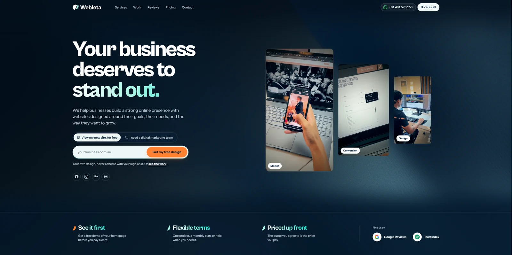

# Webleta website



The Webleta website is built with Next.js App Router and exported as a static site.

## Local development

Use Node.js 22 (see `.node-version`), then install dependencies and start the development server:

```powershell
npm.cmd ci
npm.cmd run dev
```

Open [http://localhost:3000](http://localhost:3000).

React Grab is available in development for selecting elements and copying their source context. It is excluded from production builds.

## Checks and production preview

```powershell
npm.cmd run lint
npm.cmd run typecheck
npm.cmd run build
npm.cmd run preview
```

The build exports the site to `out/`. The preview command serves that export at [http://localhost:4173](http://localhost:4173).

## Project structure

- `app/`: routes, layout, and global styles.
- `components/`: page sections and shared components.
- `content/`: website copy and content.
- `public/`: images and other static assets.
- `qa/`: website verification scripts.

See [DEPLOYMENT.md](DEPLOYMENT.md) for the deployment report and staging details. Its hosting information is dated; verify the current setup before relying on it.
